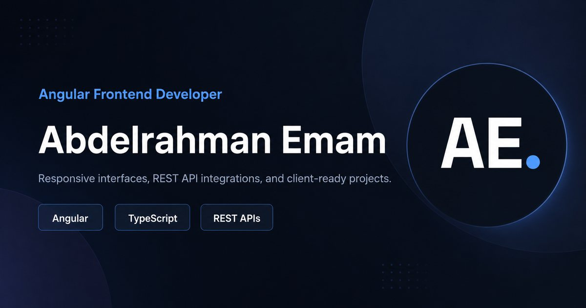

# Abdelrahman Emam | Portfolio & CV

<p align="center">
  <a href="https://abdelrahman-emam-portfolio.vercel.app/">
    
  </a>
</p>

<p align="center">
  
</p>

<p align="center">
  <a href="https://angular.dev/"></a>
  <a href="https://www.typescriptlang.org/"></a>
  <a href="https://tailwindcss.com/"></a>
  <a href="https://vercel.com/"></a>
</p>

<p align="center">
  <a href="https://abdelrahman-emam-portfolio.vercel.app/">🌐 Live Portfolio</a>
  ·
  <a href="https://abdelrahman-emam-portfolio.vercel.app/cv">📄 Live CV / Resume</a>
  ·
  <a href="https://www.linkedin.com/in/abd-el-rahman-emam">💼 LinkedIn</a>
  ·
  <a href="https://github.com/Abdelrahman-Tamer">🐙 GitHub</a>
  ·
  <a href="mailto:abdelrahmanacc84@gmail.com">✉️ Email</a>
</p>

---

## 📌 Overview

This is the official production portfolio and CV platform for **Abdelrahman Emam**, an **Angular & Frontend Developer** based in Cairo, Egypt. 

The application is engineered as a high-performance Single Page Application (SPA) with **Server-Side Rendering (SSR)** and **static prerendering**, presenting real-world client deliverables, production platforms, e-commerce systems, technical skills, services, a dedicated interactive CV route with PDF download, and an automated EmailJS contact flow.

---

## ✨ Key Features & Architecture

| Feature | Description |
| :--- | :--- |
| **Bilingual (EN / AR)** | Full Arabic (RTL) and English (LTR) language switching with complete typography and directional adaptation. |
| **Interactive CV (`/cv`)** | Dedicated resume route with real-time language toggle and direct PDF export (`/Abdelrahman-Emam-CV.pdf`). |
| **Theme Engine** | Persistent Dark & Light modes with smooth color transitions and zero flash. |
| **Project Showcase** | Detailed case studies covering problems, solutions, outcomes, tech stacks, and live links. |
| **Contact & WhatsApp Flow** | Interactive EmailJS contact form with instant validation, direct mail, phone, and contextual WhatsApp chat. |
| **Technical SEO** | Automated Open Graph tags, Twitter cards, canonical links, Schema.org JSON-LD, sitemap.xml, and robots.txt. |
| **Speed & Core Web Vitals** | WebP/AVIF responsive image pipeline, lazy-loaded standalone components, and zero layout shift (Zero CLS). |

---

## 🚀 Featured Projects

| Project | Tech Stack | Type & Description | Live Link |
| :--- | :--- | :--- | :--- |
| **Receipta Pro** | JavaScript ES6+, Firebase, jsPDF, RTL UI | **Confidential Client Project** — Electronic Arabic receipt management system with offline sync and PDF generation. | 🔒 *Private Code* |
| **Milano Travel** | Angular 22, TypeScript, SSR & Prerender, Technical SEO | **Travel Agency Platform** — Arabic luxury hotel showcase and direct 3-step WhatsApp enquiry flow across 38+ routes. | [Live Demo](https://milanotravel.vercel.app/) |
| **FreshCart** | Angular 22, TypeScript, Bootstrap 5, JWT, Stripe | **E-commerce Platform** — High-performance SPA with product catalog, cart, wishlist, auth guards, and Stripe checkout. | [Live Demo](https://fresh-cart-roan-seven.vercel.app/) |
| **NileGuide** | ASP.NET Core, Angular, SQL Server, REST APIs | **Tourism Platform** — Graduation project contributor building REST APIs, reports, authentication, and trip planning UI. | [Live Demo](https://www.nileguide.online/) |
| **Doccure** | HTML5, CSS3, Bootstrap 5, jQuery | **Healthcare Platform** — Doctor dashboard, patient records, and responsive appointment scheduling interface. | [Live Demo](https://doccure-psi.vercel.app/) |
| **Bookmarker** | JavaScript ES6+, Bootstrap 5, RegEx, localStorage | **Productivity Tool** — Link bookmark manager with real-time RegEx validation and persistent storage. | [Live Demo](https://bookmark-manager-em.vercel.app/) |

---

## 🛠️ Tech Stack & Tooling

* **Framework & Core**: Angular 22 (Standalone Components, Signals, Strict TypeScript)
* **Styling**: Tailwind CSS 4, Vanilla CSS Design Tokens, CSS Logical Properties
* **SSR & Prerendering**: Angular SSR & Node.js server engine
* **State & Data**: Angular Signals, Reactive Forms, RxJS, REST APIs
* **Testing & Quality**: Vitest & Angular CLI Test Suite
* **Assets & Media**: WebP Image Pipeline, SVG vector icons
* **Deployment & CI**: Vercel / Cloudflare Pages / Node SSR Server

---

## 📁 Repository Structure

```text
├── public/
│   ├── images/                     # Optimized WebP project previews & mockups
│   ├── Abdelrahman-Emam-CV.pdf     # Direct downloadable PDF resume
│   ├── og-image.jpg                # Social sharing OpenGraph banner
│   ├── sitemap.xml & robots.txt    # Search engine discovery configuration
│   └── site.webmanifest            # PWA manifest metadata
├── src/
│   ├── app/
│   │   ├── core/
│   │   │   ├── config/             # Public EmailJS & contact configuration
│   │   │   ├── data/               # Central portfolio data & project facts
│   │   │   ├── models/             # Strict TypeScript data models
│   │   │   ├── seo/                # SEO metadata & JSON-LD schemas
│   │   │   └── services/           # Language (RTL/LTR), Theme, and SEO services
│   │   ├── pages/
│   │   │   ├── cv/                 # Dedicated bilingual CV route & controls
│   │   │   └── portfolio/          # Main portfolio layout and feature sections
│   │   └── shared/
│   │       └── components/         # Reusable buttons, cards, and skill components
│   └── styles.css                  # Global tokens, theme variables, and Tailwind imports
└── angular.json                    # Angular workspace & build configuration
```

---

## 💻 Getting Started Locally

### Prerequisites
* **Node.js**: `v20.x` or `v22.x`
* **npm**: `v10.x` or later

### Installation

```bash
# 1. Clone the repository
git clone https://github.com/Abdelrahman-Tamer/MyPortfolio.git

# 2. Navigate to project directory
cd MyPortfolio

# 3. Install dependencies
npm install

# 4. Start local development server
npm start
```

Open your browser at `http://localhost:4200/` to explore the live application.

---

## 🧪 Available Scripts

| Command | Purpose |
| :--- | :--- |
| `npm start` | Runs the Angular development server on `http://localhost:4200/` |
| `npm run build` | Builds the production bundle with SSR and static prerendering |
| `npm test` | Executes unit tests with Vitest |
| `npm run watch` | Builds and watches for changes in development mode |
| `npm run serve:ssr:my-portfolio` | Runs the Node.js SSR production server locally |

---

## 🚢 Production Deployment

The project is pre-configured for seamless deployment on **Vercel**, **Cloudflare Pages**, or **Node.js SSR hosts**:

* **Framework Preset**: Angular
* **Build Command**: `npm run build`
* **Static Output Directory**: `dist/my-portfolio/browser`
* **Server Entry**: `dist/my-portfolio/server/server.mjs`

---

## 👤 Author

**Abdelrahman Emam**  
*Frontend Developer | Angular Developer*  
📍 Cairo, Egypt  

* 🌐 **Portfolio**: [abdelrahman-emam-portfolio.vercel.app](https://abdelrahman-emam-portfolio.vercel.app/)
* 📄 **CV / Resume**: [abdelrahman-emam-portfolio.vercel.app/cv](https://abdelrahman-emam-portfolio.vercel.app/cv)
* 💼 **LinkedIn**: [linkedin.com/in/abd-el-rahman-emam](https://www.linkedin.com/in/abd-el-rahman-emam)
* 🐙 **GitHub**: [github.com/Abdelrahman-Tamer](https://github.com/Abdelrahman-Tamer)
* ✉️ **Email**: [abdelrahmanacc84@gmail.com](mailto:abdelrahmanacc84@gmail.com)
